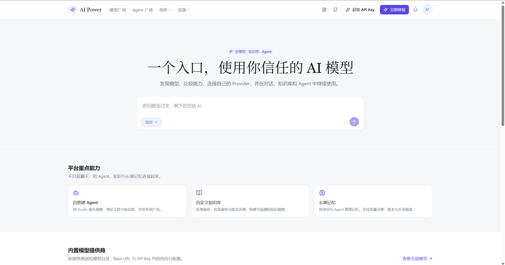
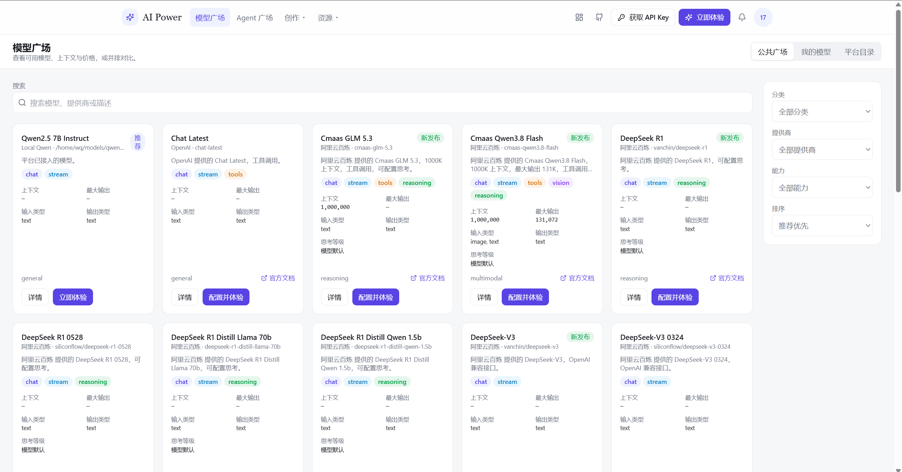
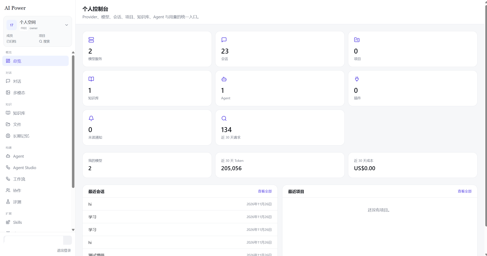
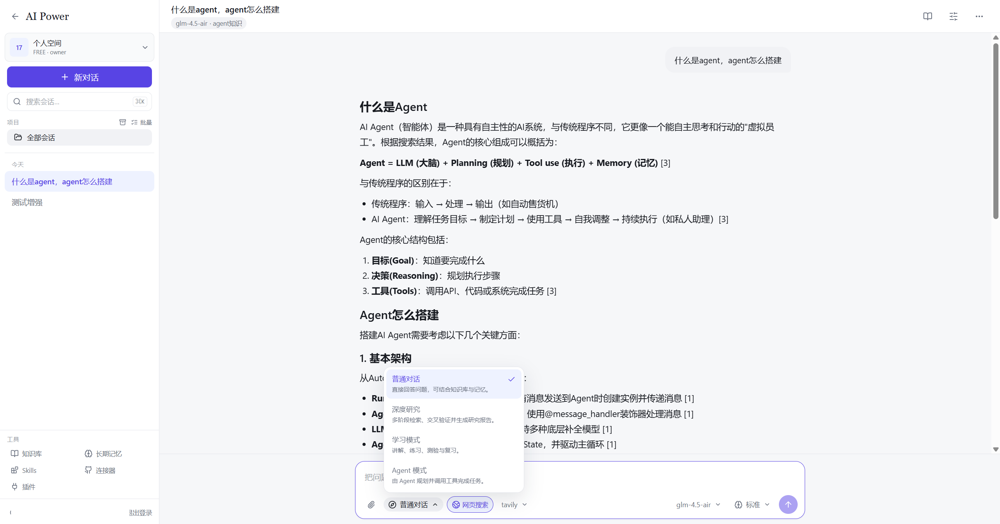
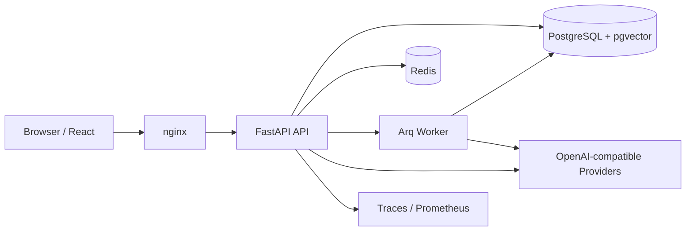

# AI Power

一个可私有部署的多租户 AI 应用平台：模型广场、流式对话、知识库 RAG、Agent / 工作流、长期记忆、检索评测与用量成本。

- **后端**：Python 3.13 · FastAPI · async SQLAlchemy · PostgreSQL/pgvector · Redis · Arq
- **前端**：React 18 · TypeScript · Vite · TanStack Query · Zustand · Tailwind
- **模型**：OpenAI 兼容 Provider（DeepSeek、智谱、阿里云百炼、OpenAI、本地 vLLM / llama.cpp）

## 项目截图

| 首页 | 模型广场 |
| :---: | :---: |
|  |  |

| 控制台总览 | 对话与知识库 |
| :---: | :---: |
|  |  |

## 功能概览

**模型与对话**
- 公共模型广场（免登录浏览、筛选、分页、模型详情）与个人模型广场；BYOK 激活，Key 加密保存，平台不内置厂商密钥
- Provider 抽象与自动路由；仅首 Token 前允许降级，流中失败不重试；模型能力校验与思考等级
- SSE 流式对话：`meta → delta*/citation*/usage → done`，失败以 `error` 终止；支持停止、重新生成、消息编辑、附件与 Markdown/JSON 导出
- 对话模式：普通对话、网页搜索、Deep Research、学习模式、Agent；Prompt 模板按会话绑定，可随时切换或移除

**知识库与 RAG**
- PDF / DOCX / CSV / MD / TXT / HTML / XLSX / PPTX 解析，URL / 站点导入，可选视觉 OCR
- Arq 持久化入库队列：租约、重试、死信、`(user, kb, content_hash)` 幂等，失败写入类型化错误码
- bge-m3 + pgvector HNSW；pg_trgm 词法召回 + 向量召回，RRF 融合，可选 bge-reranker 重排
- 引用只由实际进入 Prompt 的检索块生成，不解析模型输出；`<reference_material>` 标记为不可信数据
- Knowledge Studio：解析 / 清洗 / 分块 / Embedding 处理画布，草稿预览与原子应用；检索画布与调试页

**Agent、工作流与协作**
- Supervisor + retrieval / math 子 Agent，JSON 工具协议，工具白名单与 AST 计算器
- 自定义 Agent、插件（加密凭证、SSRF 防护）、MCP tools/resources/prompts
- 版本化 DAG 工作流：LLM / 检索 / 工具 / Agent / 条件 / 并行 / Join / Review / Loop / HTTP / Code / Database 等节点
- 异步运行、事件持久化与 `after` / `Last-Event-ID` 回放、检查点恢复、取消；Review 节点人工审批
- Planner–Worker–Critic 协作；Agent Studio 画布、AI Builder、测试运行与市场发布

**记忆与评测**
- 用户 / 项目 / Agent / 全局作用域；异步抽取、去重、更新建议、候选审核、版本与关系图
- 记忆权限矩阵、来源授权、使用事件与消息快照；检索排序结合向量、词法、重要性、时效
- 检索评测：Recall / Precision / MRR / NDCG / 文档 Recall / 节点耗时，运行对比与优化建议
- Prompt Lab、Model Arena、Model Evaluation Center

**平台化**
- Workspace / 成员 / `X-Workspace-Id` 多租户隔离；跨租户统一 404
- JWT access + refresh 轮换/吊销；API Key scope、过期、限流；登录限流
- append-only `usage_events` 用量账本与价格快照；按日 / Provider / 模型 / 来源 / Key 聚合
- Trace、Prometheus 指标、配额、每日预算与告警、审计日志
- Webhook HMAC 签名与重试；Python 同步/异步 SDK

## 架构



- API 启动时执行 `alembic upgrade head`；Worker 与 API 共用镜像与 uploads volume。
- nginx 提供 SPA 静态资源并把 `/api` 反代到 API，SSE 关闭代理缓冲。
- 队列任务、工作流运行、协作运行与事件均可持久化、回放和取消。

## 技术栈

| 层 | 技术 |
|---|---|
| 后端 | Python 3.13、FastAPI、Pydantic、async SQLAlchemy、Alembic、Arq |
| 数据 | PostgreSQL 16 + pgvector + pg_trgm、Redis 7；测试使用 SQLite |
| AI | bge-m3 Embedding、bge-reranker-v2-m3、OpenAI 兼容 Provider |
| 前端 | React 18、TypeScript、Vite、TanStack Query、Zustand、Tailwind |
| 部署 | Docker Compose、nginx；可选 Prometheus、Caddy HTTPS |
| 测试 | pytest、Vitest、Playwright |

## 快速开始

### Docker（推荐）

要求：Docker Desktop / Docker Engine（含 Compose 插件）。零基础步骤见 **[教程.md](./教程.md)**。

```bash
cp .env.example .env
# 必改：POSTGRES_PASSWORD；按需配置 JWT_SECRET、模型与 Embedding 地址
docker compose up -d --build
```

打开 <http://localhost:8080>，注册账号后到「模型广场」用自己的 API Key 激活模型即可对话。

| 服务 | 地址 | 说明 |
|---|---|---|
| Web | `http://localhost:8080` | nginx + React SPA |
| API | `http://localhost:8002` | FastAPI（容器内 8000） |
| Postgres | `localhost:5432` | pgvector/pg16 |
| Redis | `localhost:6379` | 队列与限流 |

### 本地开发

```bash
uv venv --python 3.13 .venv
uv pip install --python .venv/Scripts/python.exe -e ".[dev]"

docker compose up -d postgres redis
.venv/Scripts/python.exe -m alembic upgrade head
.venv/Scripts/python.exe -m uvicorn app.main:app --reload --port 8000
.venv/Scripts/python.exe -m arq app.worker.WorkerSettings   # 另开终端

cd web && npm install && npm run dev                         # http://localhost:5173
```

Windows 下 Docker 运行在 WSL 时，连接宿主机请使用局域网 IP，不要用 `localhost`。Vite 开发服务器将 `/api` 代理到 `VITE_PROXY_TARGET`（默认 `http://192.168.29.100:8002`）。

## 关键配置

| 变量 | 说明 |
|---|---|
| `POSTGRES_PASSWORD` | Compose 必填；首次启动前设定 |
| `JWT_SECRET` | 非 dev 环境必须替换开发默认值 |
| `PROVIDER_SECRET_KEY` / `WEBHOOK_SECRET_KEY` | 非 dev 环境必填；用于 Provider 密钥与 Webhook 签名 |
| `DATABASE_URL` / `REDIS_URL` | 本地开发使用；Compose 内自动覆盖为服务名 |
| `INNER_MODELS_DIR` / `INNER_MODELS_PROVIDERS` | 内置模型目录路径与启用的 Provider（默认 `*`） |
| `RERANK_ENABLED` / `RERANK_BASE_URL` | 重排开关与地址；无重排服务时设为 `false` |
| `CORS_ORIGINS` | 允许的浏览器来源，逗号分隔 |
| `UPLOAD_DIR` | 上传文件目录（Compose 使用 volume） |

完整变量见 [`.env.example`](./.env.example)。

## 测试

```bash
# 后端
.venv/Scripts/python.exe -m pytest
.venv/Scripts/python.exe -m pytest -n auto
.venv/Scripts/python.exe -m ruff check .
.venv/Scripts/python.exe -m ruff format --check .

# 前端
cd web && npm run typecheck && npm test && npm run build
cd web && npx playwright install chromium && npm run test:e2e
```

pgvector / pg_trgm 集成测试需要设置 `TEST_POSTGRES_URL`；默认测试使用 SQLite。

## 检索评测

项目内置 20 文档 / 50 题中文检索评测集，指标为项目内评测结果，不代表生产流量：

| 方案 | Recall@1 | MRR |
|---|---:|---:|
| Vector（bge-m3 + pgvector） | 0.960 | 0.9767 |
| Hybrid + Rerank | 0.980 | 0.9900 |

评测平台支持数据集、并发批测、取消/重试、规则/人工/AI Judge、运行对比与优化建议。

## 目录结构

```text
app/            FastAPI 应用（routers / services / providers / agents / tools）
alembic/        数据库迁移
tests/          后端测试
web/            React 前端（含 Dockerfile 与 nginx.conf）
inner_models/   内置模型目录 JSON（智谱 / 阿里云 / OpenAI / DeepSeek）
eval/           检索评测数据集
scripts/        种子数据、评测、备份、压测
sdk/python/     Python SDK（同步/异步）
docs/           产品契约、ADR、TDD、API 文档与截图
```

## 文档

- [零基础部署教程](./教程.md)
- [项目开发说明（CLAUDE.md）](./CLAUDE.md)
- [产品简报](./PRODUCT-BRIEF.md)
- [能力契约](./docs/product/CAPABILITY.md)
- [规划与缺口清单](./docs/plan/)
- [架构决策记录（ADR）](./docs/adr/)
- [实现与验证证据（TDD）](./docs/tdd/)
- [API 文档](./docs/api/quickstart.md)
- [Python SDK](./sdk/python/README.md)

## 已知边界

- 面向单机 / 局域网部署与功能验证，不是生产级多活或高可用集群。
- 平台不内置任何厂商密钥；模型需用户自备 Base URL 与 API Key（BYOK）。
- P0–P7 功能完整；P8–P11 为 MVP 或局部完成，P12 为主要切片完成，具体边界见 [P11 缺口清单](./docs/plan/p11-gap-list.md) 与各阶段 TDD。
- `auto` 路由在解析出具体模型前只支持 standard；Agent 与网页搜索模式互斥。
- Deep Research 来源为 KB 级，不支持固定到单文档；网页研究使用单一搜索 Provider。
- MCP 工具尚未做风险分类；审批策略记忆与成本上限仍属后续工作。
- 实时语音、Google Drive/Gmail/Calendar OAuth 未实现；GitHub 连接器只读；媒体配额与自动内容审核未实现。
- 知识处理受现有解析器限制；OCR 覆盖 PDF/图片，DOCX/PPTX 内嵌图像仍走解析器逻辑。
- 多 KB 检索使用首个 KB 的 Embedding/Reranker 参数；项目文件工具只读取已索引分块。
- 记忆保留策略只标记过期、不硬删除，暂无通知；关系过滤只支持一跳。

## 安全说明

- `.env`、数据库、上传文件与本地简历不纳入版本库。
- Provider / Webhook 密钥加密存储；API Key 只保存 SHA-256 与 prefix，明文仅创建时展示一次。
- 不记录 `Authorization`、Provider Key 或完整文档正文。
- 跨用户 / 跨 Workspace 资源统一返回 404。
- 插件、HTTP 节点、Webhook、URL 导入与 MCP 出站均有 SSRF / 私网 / 重定向与大小限制。